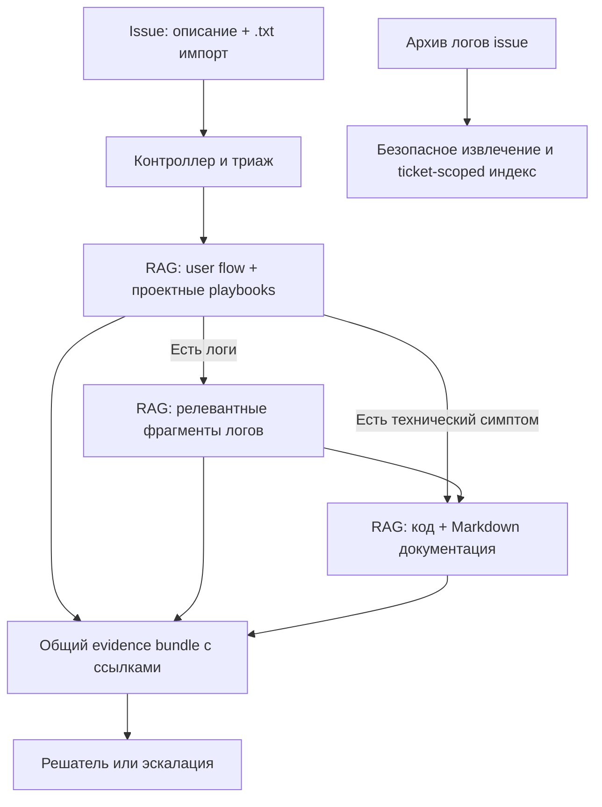

# Дизайн: контекстный RAG для обработки issue

## Цель

Issue должен разбираться на основе его описания, связанных с ним логов и знаний конкретного продукта: user flow, исходного кода, Markdown-документации и кратких Markdown playbook-инструкций. Оркестратор подключает только нужные роли и передаёт им небольшие найденные фрагменты с источниками, чтобы уменьшить расход токенов и сохранить проверяемость результата.

## Что есть сейчас

- Issue уже создаётся веб-формой из заголовка и описания и отправляется в `POST /api/v1/sources/{id}/tickets`.
- Есть проектный гибридный поиск по завершённым индексам. Конвейер ticket-agent вызывает триаж, затем поиск по запросам триажа, затем решатель. Поиск — не отдельный LLM-агент; обычно выполняются два LLM-вызова, а невалидный JSON может добавить repair-вызов.
- Проектные Markdown-документы и user flow существуют как материалы проекта. Связанных с issue вложений и ticket-scoped индекса логов пока нет.
- Общий endpoint загрузки кладёт архив в S3, но не связывает его с issue.

## Подходы

1. **Вкладывать архив целиком в prompt.** Быстро для прототипа, но стоимость растёт с размером логов; модель получает много шума, а ссылки на точные строки ненадёжны.
2. **Ticket-scoped RAG для логов.** Хранить исходный архив как вложение issue, безопасно извлекать поддерживаемые текстовые файлы и индексировать их в отдельной области, доступной только этому issue. Retrieval выбирает ограниченные фрагменты и передаёт их агентам с именем файла и строками/временными метками. Это рекомендуемый подход: он сохраняет связь логов с обращением и позволяет контролировать бюджет контекста.
3. **Сначала подключить внешние системы через MCP.** Даёт доступ к актуальным логам, но требует конфигурации провайдеров, прав доступа, согласия пользователя и отдельной обработки ошибок. Для первого этапа избыточно.

## Выбранное направление

Реализовывать поэтапно подход 2. Пользователь вручную прикладывает архив логов; скрипт автосбора и MCP остаются экспериментальными последующими этапами. `.txt` импортирует текст обращения в существующую форму: первая непустая строка становится заголовком, оставшийся текст — описанием; поля можно поправить перед созданием.

Логи не добавляются в общий индекс проекта: они относятся к конкретному issue, могут содержать чувствительные данные и не должны влиять на поиск по другим обращениям. Исходный архив хранится как артефакт issue; индексируются только поддерживаемые текстовые записи после локальной фильтрации и редактирования секретов.

## Поток обработки

Контроллер работает от минимального issue-контекста и принимает детерминированное решение о следующих шагах. Retrieval каждого домена доступен через общий интерфейс с фильтрами по project, issue и index type. User flow помогает определить затронутый путь продукта; log specialist извлекает временное окно, ошибки и stack trace; code investigator ищет только по областям, подсказанным flow и логами. Не каждый issue вызывает все роли: простой вопрос может остановиться после flow/docs-поиска, а code investigator запускается при наличии признаков дефекта. Решатель получает компактный deduplicated evidence bundle, а не исходный проект или полный архив.

## Источники контекста

- **Описание issue:** первичный сигнал, ограничения и ожидаемое поведение от пользователя.
- **User flow:** шаги ожидаемого сценария и точка отклонения; используется для раннего сужения области поиска.
- **Ожидаемое поведение и действия пользователя:** сопоставление описанного результата и фактически пройденных шагов с user flow и документацией помогает отличить дефект от штатного сценария, пропущенного шага или неверного ожидания.
- **Логи issue:** точные ошибки, stack traces и временные последовательности; хранятся и ищутся в области одного issue.
- **Эксплуатационные сигналы:** сообщения ядра/системы о нехватке места или памяти, OOM killer, завершении процессов по лимиту ресурсов, заполнении диска или inode, а также сведения о конфигурации окружения. Они помогают отделить проблему ресурсов/деплоя от ошибки приложения.
- **Код:** подтверждение фактической реализации и возможного дефекта.
- **Markdown-документация:** спецификации, инструкции и описание ожидаемого поведения.
- **Markdown playbooks/skills проекта:** короткие версионируемые правила диагностики, терминология и локальные процедуры. Они индексируются/извлекаются по релевантности, а не целиком добавляются в каждый prompt.

Все агенты, которым нужен контекст, обращаются к retrieval-слою по назначенным типам источников. Результаты включают `source_ref`, путь, строки либо временной интервал и тип источника. Агент не должен формировать утверждения о поведении продукта без подтверждающего evidence.

## Специалисты и бюджет токенов

Планируемые узкие роли: ticket router/triage, flow analyst, log analyst, code investigator и resolution writer. Это роли графа, а не пять безусловных параллельных запусков. Оркестратор выбирает специалистов условно; ограничивает число проходов и объём токенов на роль; сохраняет append-only trace; удаляет дубли evidence между поисками. Текущий каскад triage/strong/cheap остаётся основой выбора моделей, а модели и лимиты для новых ролей добавляются через расширяемую конфигурацию ролей.

Log analyst также определяет, похожи ли свидетельства на эксплуатационную причину, а не на дефект приложения: заполненный диск/иноды, нехватка памяти, OOM kill, лимит контейнера, конфигурация окружения или отказ внешней зависимости. При явных признаках ресурсного ограничения оркестратор сначала собирает соответствующие факты и рекомендации по проверке окружения; code investigator запускается только при отдельных признаках дефекта. Неоднозначный случай оформляется как гипотеза с перечислением недостающих данных, без уверенного обвинения кода.

Flow analyst сверяет ожидаемый пользователем результат с описанным сценарием. Если user flow и документация подтверждают штатное поведение, оркестратор направляет issue в маршрут объяснения/инструкции: ответ доброжелательно объясняет происходящее, приводит ссылку на источник и предлагает конкретный следующий шаг. Это не маркируется как дефект. Если контекста недостаточно, агент задаёт короткий уточняющий вопрос вместо уверенного вывода.

## Загрузка и обработка логов

- Отдельный upload у issue для `.zip` и поддерживаемого `.tar.gz`; общий endpoint создания ticket остаётся прежним.
- Сервер связывает метаданные вложения с issue, исходный архив хранит в S3.
- При распаковке проверяются размер архива и распакованный размер, типы файлов, дубли и небезопасные пути. В retrieval поступают только поддерживаемые текстовые файлы; бинарные данные и неизвестные форматы игнорируются или объяснимо отклоняются.
- Парсер сохраняет путь, номера строк, временные метки и смещения исходного файла. Секреты и потенциальные персональные данные маскируются до embedding и передачи фрагментов модели.
- Обработка остаётся локальной по умолчанию. В облачную модель отправляются лишь извлечённые фрагменты, если пользователь выбрал облачного провайдера.
- Повторный запуск issue переиспользует его индекс логов, пока вложения не изменились; изменение/удаление архива инвалидирует или удаляет связанный индекс.

## Skills и MCP

Markdown playbooks — первая форма проектного agent context: пользователь добавляет и версионирует короткие инструкции, система retrieves их по теме issue. MCP — экспериментальный read-only адаптер к настроенным источникам логов/наблюдаемости; его результат нормализуется в тот же формат evidence, что и архивы. Подключение MCP не должно обходить проектные права и ограничения контекста. Скрипт автосбора логов также экспериментальный, выключен по умолчанию и запускается пользователем с предварительным просмотром состава данных.

## План этапов

1. **Вход issue:** .txt импорт в существующую форму с редактируемым заголовком/описанием; отдельная загрузка архива логов и связка вложения с issue.
2. **Ticket-scoped log RAG:** безопасное извлечение, фильтрация и разбиение логов на chunks; metadata и индекс, ограниченные issue; citations до файла/строк/времени.
3. **Единый retrieval-контекст:** единая модель evidence для user flow, логов issue, кода, Markdown-документации и project playbooks; фильтры по типу и бюджеты.
4. **Условный граф специалистов:** flow/log/code роли подключаются по результатам триажа и retrieval; решение ссылается на единый evidence bundle; строгие лимиты шагов и trace каждого вызова.
5. **Оценка качества/стоимости:** golden issues с эталонными flow, логами и code locations; измерять recall по типам источников, корректность evidence, токены/$ за issue, долю ответов и эскалаций. Сравнить с текущим two-LLM-step baseline.
6. **Экспериментальные интеграции:** проектные MCP-коннекторы к логам и пользовательский auto-collector script за feature flag; сначала read-only, локально, с preview и аудитом.

## Критерии результата

- Агент использует описания issue и релевантные данные из user flow, логов и кода/документации, а не загружает весь проект в prompt.
- При заполненном диске, нехватке памяти или OOM kill агент умеет указать на вероятную эксплуатационную причину, показать подтверждающие фрагменты и не объявлять это дефектом кода без дополнительных свидетельств.
- Если пользователь ожидает поведение, отличное от подтверждённого user flow или документации, агент объясняет штатный сценарий со ссылкой на источник и конкретным следующим шагом, не создавая ложный диагноз дефекта.
- Ответы и эскалации содержат проверяемые ссылки на project или ticket evidence.
- Логи одного issue не появляются в retrieval другого issue.
- Token usage и стоимость измеряются по ролям и по всему issue; сравнение с текущей конфигурацией показывает качество при меньшем/контролируемом бюджете.
- Скрипт автосбора и MCP не требуются для базового сценария загрузки.

## Границы и жизненный цикл

- **Область проекта:** в существующей модели project соответствует `source_id`. Индекс архива и поиск ограничиваются парой `(source_id, ticket_id)`; логи не доступны другим issue или проектам.
- **Версия контекста проекта:** каждый запуск использует последние завершённые индексы проекта на момент старта. `run_id`, `artifact_id` и исходный путь/строки сохраняются в evidence references и trace. Новый импорт проекта влияет на новые запуски, но не переписывает trace старых запусков.
- **Обработка архива:** загрузка создаёт версионированное вложение и ставит extraction/indexing в очередь. UI показывает состояние вложения; запуск агента доступен, когда обработка завершилась. При ошибке UI показывает понятную причину и действие повтора. Загрузка архива сама по себе не запускает разбор issue.
- **Замена и удаление:** новое вложение становится актуальной версией для следующего запуска; успешные embeddings переиспользуются при повторных запусках. При удалении вложения или issue связанный ticket-scoped индекс удаляется. Удаление S3-объекта следует политике удаления issue.
- **Поиск логов:** переиспользовать текущий гибридный путь (dense + BM25, с существующим optional rerank) и те же ограничения candidate/top-k, добавив ticket scope и специфичный chunking по временным окнам/stack trace. Не создавать второй независимый поисковый стек.
- **Приватность:** действуют текущие правила продукта: данные остаются локально по умолчанию; облачная модель получает только выбранные retrieval-фрагменты после явного выбора облачного провайдера. Оригинальный архив не передаётся в prompt. Сквозная обработка удаляет/маскирует найденные секреты и чувствительные значения перед embedding и generation, а исходный путь/offset сохраняет для трассировки без записи содержимого логов в обычные application logs.

## Детали для OpenSpec-проработки

- Допустимые расширения текстовых логов, лимиты сжатого и распакованного архивов, кодировки и поведение для частично читаемых архивов.
- Схема состояний вложения и API-контракты для upload, статуса, retry, замены и удаления.
- Формат skill/playbook Markdown и метаданные назначения ролям; процесс утверждения и версионирования.
- Точные роли, token budget, max iterations и routing scenarios. Они задаются расширяемой конфигурацией; golden-набор закрепляет ожидаемые маршруты и качество.
- Таксономия причин инцидента, признаки для маршрута resource/environment versus application defect, пороги уверенности и поведение на неоднозначных логах. Golden-набор должен включать OOM, нехватку места/инодов, обычные дефекты кода и неоднозначные случаи.
- Таксономия обращений «ожидаемое поведение / вопрос по использованию» и граница между объяснением, уточняющим вопросом и реальным дефектом. Golden-набор должен включать документированный штатный сценарий, пропущенный шаг, ошибочное ожидание и случай, где данных недостаточно.
- Специфические правила redaction и аудита, совместимые с текущей локальной политикой и явным выбором облачной модели.
